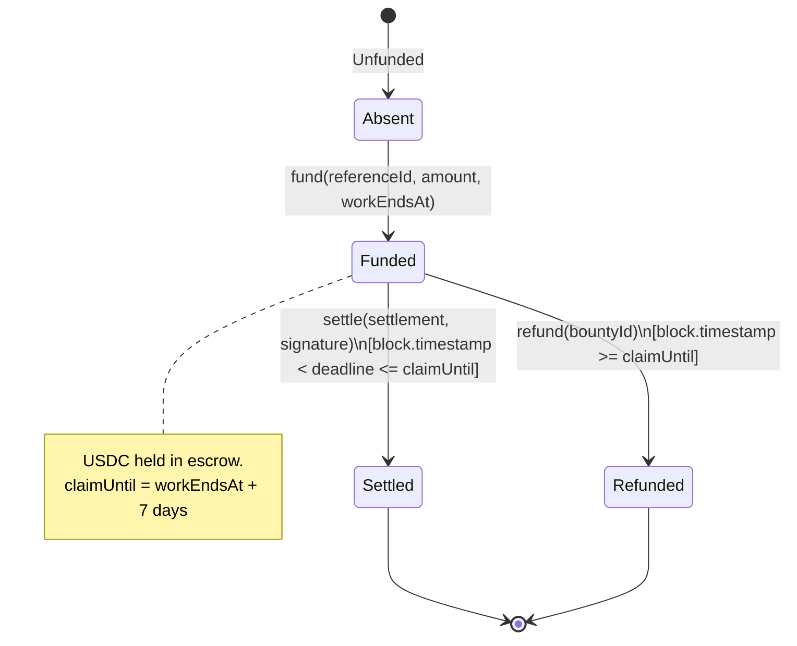

# GitBounty Escrow Smart Contract Workspace

> **Hardhat 3 workspace for the `GitBountyEscrow.sol` smart contract deployed on the Avalanche Fuji C-Chain.**

[](https://soliditylang.org/)
[](https://openzeppelin.com/)
[](https://build.avax.network/docs/primary-network/verify-contract/hardhat)
[-success)](#contract-testing)

---

## 1. Escrow State Machine



---

## 2. Deployed Fuji Contract

| Parameter | Value |
|---|---|
| **Network** | Avalanche Fuji C-Chain (Chain ID `43113`) |
| **Contract Address** | [`0xc8ff1527BF4d43A3bC7EA3d9fb415D5647739f65`](https://testnet.snowtrace.io/address/0xc8ff1527BF4d43A3bC7EA3d9fb415D5647739f65) |
| **Deployment Transaction** | [`0x302e9e0dce61ad1dd1fa8a7dccbca71c9f7d3f15a185ee0204fa728b84952e4d`](https://testnet.snowtrace.io/tx/0x302e9e0dce61ad1dd1fa8a7dccbca71c9f7d3f15a185ee0204fa728b84952e4d) |
| **Deployment Block** | `59609397` |
| **Official Test USDC** | `0x5425890298aed601595a70AB815c96711a31Bc65` |
| **Authorization Signer** | `0xf066119be9A9684a81Bd40B153A2E79d5451a8e0` |

---

## 3. Development & Testing Commands

```powershell
# Install dependencies
npm install

# Run comprehensive Hardhat unit test suite
npm test

# Run script guard tests
npm run test:scripts
```

### Deterministic Test Results
```text
  GitBountyEscrow
    ✔ funds the payer-derived ID with the exact token amount
    ✔ rejects fee-on-transfer funding without leaving state behind
    ✔ settles permissionlessly to the signed recipient and blocks replay/refund
    ✔ rejects altered terms, the wrong signer/domain, and malformed signatures
    ✔ allows settlement just before the boundary and refund at the boundary
    ✔ preserves funded state when a token transfer fails
    ✔ keeps cross-bounty liabilities conserved despite direct donations
    ✔ rejects invalid constructor and funding terms
    ✔ matches the shared viem, Solidity, and Python EIP-712 golden vector

  9 passing (100% pass rate)
```

---

## 4. Fuji Deployment Verification

```powershell
# Verify configuration and RPC status
node scripts/fuji.mjs inspect --network fuji
```
Deployment artifacts, receipts, constructor arguments, and compilation metadata are stored in [`deployments/fuji/`](deployments/fuji/).
