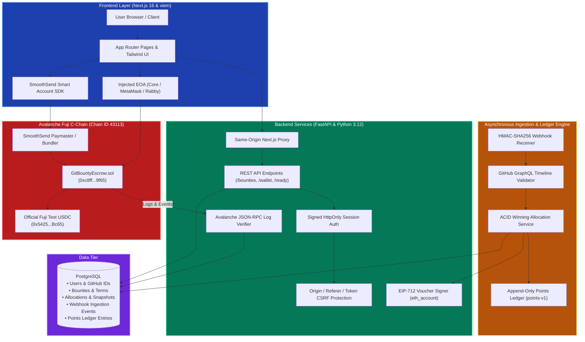
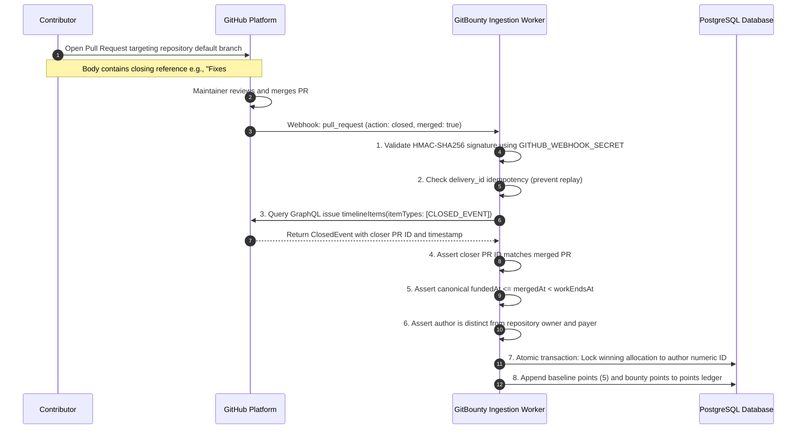
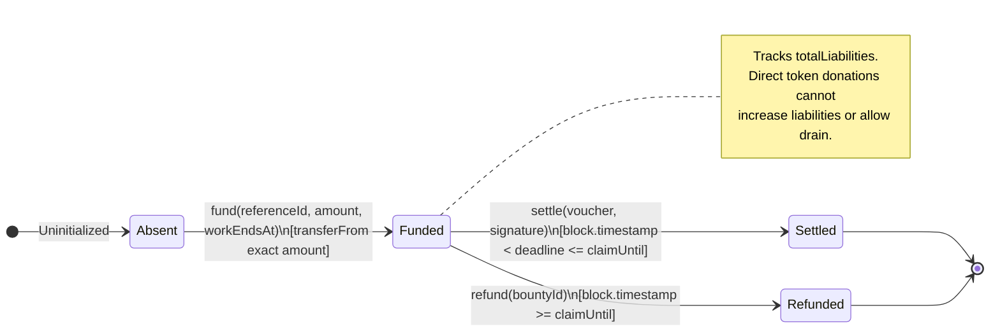
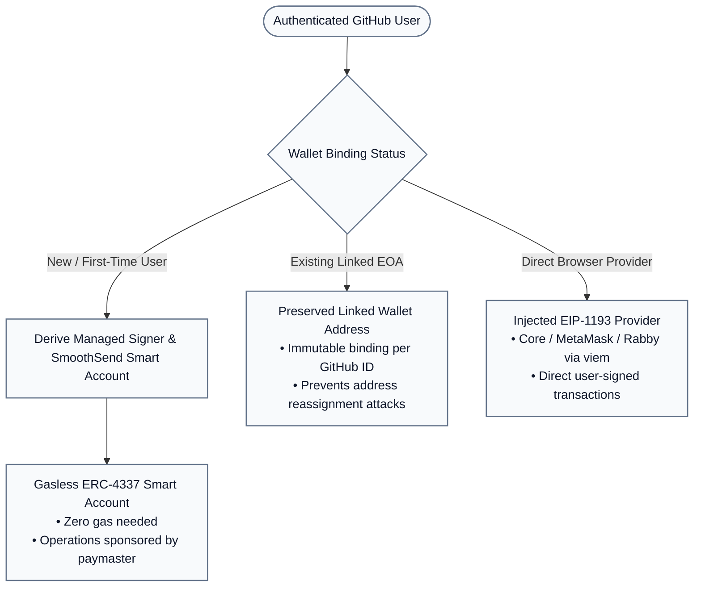

# GitBounty Architecture Specification

---

## 1. System Overview & Shipped Status

GitBounty connects GitHub's developer platform with the Avalanche C-Chain network through an attested escrow architecture. The backend cryptographically validates GitHub repository events, and the on-chain smart contract enforces fund escrow, authorization verification, and non-reentrant token settlement.

### Implementation Status Matrix

| Component | Implemented Technologies & Artifacts | Status |
|---|---|---|
| **Web Frontend** | Next.js 16.4.6, React 19.3.0, TypeScript 5.9, Tailwind CSS, viem 2.57 | **Production Ready** |
| **Backend API** | FastAPI, Python 3.12, asyncpg, SQLAlchemy, Pydantic, httpx | **Production Ready** |
| **Database** | PostgreSQL with 20 numbered migrations applied (Supabase compatible) | **Production Ready** |
| **Smart Contract** | Solidity 0.8.30 (EVM `cancun`), OpenZeppelin Contracts v5.2.0 | **Deployed on Fuji** |
| **Escrow Address** | `0xc8ff1527BF4d43A3bC7EA3d9fb415D5647739f65` (Fuji Block 59609397) | **Verified on Snowtrace** |
| **Wallet & Account Abstraction** | SmoothSend ERC-4337 Smart Accounts + Injected EOA Discovery | **Production Ready** |
| **GitHub Integration** | GitHub OAuth + GitHub App HMAC Webhook Inbox + GraphQL Timeline | **Production Ready** |

---

## 2. Component Topology



---

## 3. GitHub Verification & Eligibility Pipeline

GitBounty does not allow clients to self-report merges or winners. Eligibility is authoritatively proven through the GitHub App and GraphQL APIs:



---

## 4. Smart Contract Architecture

The escrow smart contract [`GitBountyEscrow.sol`](file:///c:/Users/dipes/Coding/Webdev/Gitbounty/main-gitbounty/gitbounty/contracts/contracts/GitBountyEscrow.sol) is non-upgradeable and deployed on Avalanche Fuji.

### Escrow State Machine



### Identifier Derivation

To prevent identifier collisions, front-running, or cross-chain replays, bounty IDs are derived using standard ABI encoding:

$$\text{referenceId} = \text{keccak256}(\text{abi.encode}(\text{namespace}, \text{databaseBountyId}))$$
$$\text{bountyId} = \text{keccak256}(\text{abi.encode}(\text{block.chainid}, \text{address}(this), \text{payer}, \text{referenceId}))$$

Because `msg.sender` is bound as `payer`, funding from an unexpected wallet derives a different `bountyId`, protecting the intended funding parameters.

### EIP-712 Settlement Authorization

Settlement authorization digests are computed according to the EIP-712 specification:

```mermaid
classDef structStyle fill:#F8FAFC,stroke:#475569,stroke-width:2px,color:#0F172A;

class GitBountyDomain {
    +string name: "GitBountyEscrow"
    +string version: "1"
    +uint256 chainId: 43113
    +address verifyingContract: 0xc8ff...9f65
}
class Settlement {
    +bytes32 bountyId
    +address recipient
    +address token
    +uint256 amount
    +uint256 nonce
    +uint256 deadline
}
```

The voucher specifies:
* `bountyId`: The unique 32-byte hash identifying the escrow deposit.
* `recipient`: The verified contributor's linked wallet (EOA or Smart Account).
* `token`: The token contract address (`0x5425890298aed601595a70AB815c96711a31Bc65`).
* `amount`: The exact token units (USDC with 6 decimals).
* `nonce`: `0` for initial settlement (protects against authorization re-use).
* `deadline`: Voucher expiry timestamp, which must satisfy $\text{block.timestamp} < \text{deadline} \le \text{claimUntil}$.

---

## 5. Wallet Architecture & Account Abstraction

GitBounty implements a hybrid wallet model:



* **SmoothSend Account Abstraction:** Eliminates onboarding friction by provisioning an encrypted managed signer for GitHub users. Funding and settlement UserOperations are submitted to the SmoothSend bundler with developer paymaster sponsorship.
* **Direct EOA Discovery:** For power users, the frontend uses `viem` to detect and interact with standard EVM browser wallets.
* **Immutable Wallet Binding:** Once a receiving wallet address is bound to a numeric GitHub ID in PostgreSQL, it cannot be silently rewritten by subsequent sessions.

---

## 6. Security Boundaries & Trust Disclosures

1. **Attested Settlement Model:** GitBounty is an **attested escrow system**, not a fully trustless oracle. The backend signer (`0xf066119be9A9684a81Bd40B153A2E79d5451a8e0`) is trusted to honestly attest GitHub eligibility.
2. **Contract Enforces Custody:** The smart contract ensures the backend *cannot* steal funds or redirect an active bounty to an arbitrary address—the contract requires a valid voucher and respects the immutable token, recipient, and payer rules.
3. **Payer Protection:** Maintainers are guaranteed their funds cannot be locked indefinitely. Once `claimUntil` passes without a verified settlement, the maintainer can call `refund(bountyId)` directly on-chain without backend cooperation.
