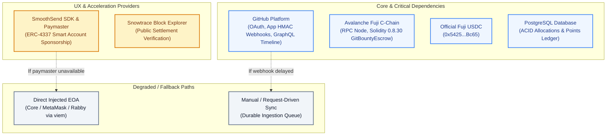

# External Dependency Boundaries and Failover Paths

This document defines GitBounty's external dependencies, trust scopes, verification evidence, and fallback behaviors.

---

## 1. System Dependencies & Failover Topology

---

## 2. Dependency Matrix

| Dependency | Purpose | Failure Mode | Fallback / Mitigation |
|---|---|---|---|
| **GitHub OAuth & App** | Authenticates users; verifies repository merges, default branch targets, and PR authors. | Webhook delays or GitHub API downtime. | Durable incoming event queue in PostgreSQL; authenticated manual sync endpoint reconciles missing timeline events. |
| **Avalanche Fuji C-Chain** | Hosts `GitBountyEscrow.sol`; executes non-reentrant USDC settlements and refunds. | RPC endpoint unresponsive or rate-limited. | Configurable `ESCROW_RPC_URL` allows instant failover to secondary Fuji RPC providers; settlement vouchers remain valid until `deadline`. |
| **Official Fuji USDC** | Six-decimal standard currency token (`0x5425890298aed601595a70AB815c96711a31Bc65`). | Token contract paused or transfer failure. | `SafeERC20` wrapper reverts transactions safely without corrupting escrow liabilities or marking bounties as paid. |
| **SmoothSend Account Abstraction** | Bundles and sponsors `UserOperations` for gasless funding and claims. | Paymaster sponsorship credits exhausted or origin CORS mismatch. | Direct EOA web3 wallet interaction via `viem`; the voucher recipient binding is preserved. |
| **PostgreSQL Ledger** | Stores user identity mappings, append-only points ledger, and winning allocations. | Database connection pool exhaustion (`EMAXCONNSESSION`). | SQLAlchemy `NullPool` and asyncpg pool bounds (max 2 connections per worker with 10s idle lifetime). |

---

## 3. Account Abstraction & Provider Boundaries

* **Decoupled Settlement Logic:** Smart contract settlement logic does not depend on SmoothSend. Anyone can submit a valid EIP-712 settlement voucher directly to `GitBountyEscrow.sol`.
* **Preserved Recipient Binding:** The settlement recipient address is determined and signed by the backend attestation service. The bundler or relayer cannot divert funds to an unauthorized address.
* **No Speculative Token Replacements:** The escrow contract is non-upgradeable and strictly binds the official Fuji test USDC.
