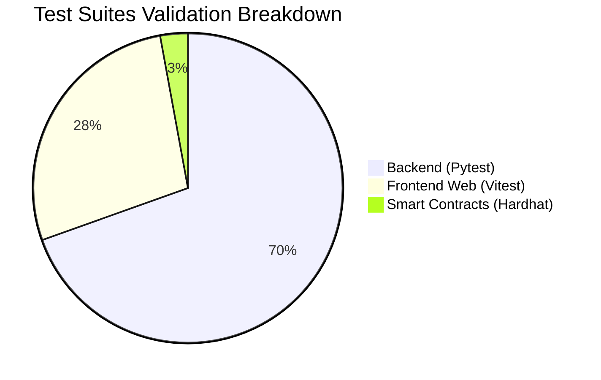
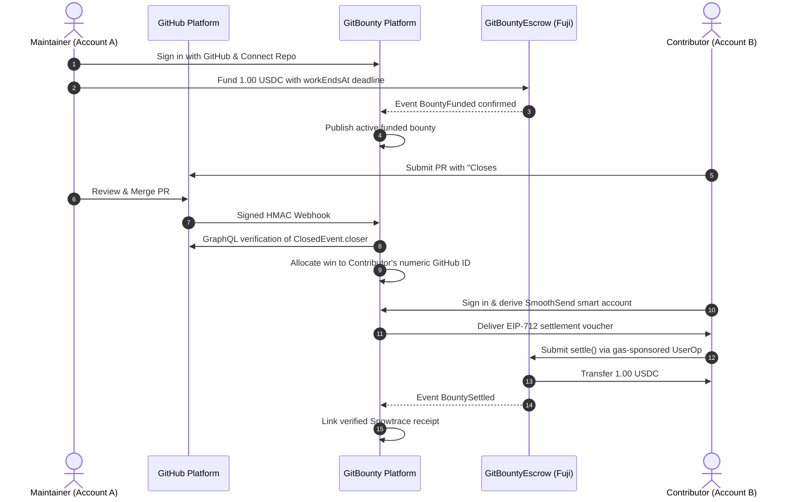

# Avalanche Builder Hub Hackathon Submission Package

---

## 1. Project Name and One-Line Description

**GitBounty** — Reward the verified author of a merged GitHub pull request with transparent reputation points and an escrow-backed USDC bounty on Avalanche.

---

## 2. Full Description

GitBounty empowers open-source repository maintainers to incentivize high-value issues with verifiable financial rewards on Avalanche, while eliminating the trust deficit that discourages external contributors.

Maintainers sign in through GitHub, connect their public repositories via the GitBounty GitHub App, and create an issue bounty with clear criteria, reputation points, and an escrowed USDC reward. The reward is pre-funded directly into a non-upgradeable Solidity escrow contract (`GitBountyEscrow.sol`) deployed on the Avalanche Fuji C-Chain.

Contributors browse published bounties, work through standard GitHub pull requests, and include standard closing keywords (e.g., `Fixes #42`). When the maintainer merges the PR, GitBounty automatically intercepts the HMAC-signed GitHub webhook, validates that the merge targeted the default branch before the deadline, and queries GitHub's GraphQL API to verify the `ClosedEvent.closer` timeline provenance.

The winning allocation is locked under an ACID database constraint to the pull request author's immutable numeric GitHub ID. Contributor onboarding is completely friction-free: contributors can use a gas-sponsored SmoothSend ERC-4337 smart account without holding native AVAX, or use their preferred browser wallet (Core, MetaMask, Rabby). GitBounty issues an EIP-712 typed settlement voucher that unlocks the escrowed USDC directly to the contributor's wallet on Avalanche, accompanied by a verified Snowtrace explorer receipt.

---

## 3. Technology Stack

```mermaid
flowchart LR
    subgraph UI["Web Application"]
        N["Next.js 16 (App Router)"]
        R["React 19"]
        V["viem 2.57"]
        SS["SmoothSend SDK"]
    end

    subgraph API["Backend Services"]
        F["FastAPI (Python 3.12)"]
        P["asyncpg & SQLAlchemy"]
        E["eth-account (EIP-712)"]
    end

    subgraph Chain["Avalanche Network"]
        C["Solidity 0.8.30 (cancun)"]
        OZ["OpenZeppelin v5.2"]
        H["Hardhat 3"]
        Fuji["Avalanche Fuji (Chain 43113)"]
    end

    UI --> API
    API --> Chain

    classDef default fill:#F8FAFC,stroke:#64748B,stroke-width:1.5px,color:#0F172A;
```

* **Frontend:** Next.js 16.4.6, React 19.3.0, TypeScript 5.9, Tailwind CSS, `viem`, Vitest.
* **Backend API:** FastAPI (Python 3.12), PostgreSQL (asyncpg, SQLAlchemy), Pydantic, httpx, cryptography.
* **Smart Contracts:** Solidity 0.8.30 (evmVersion: `cancun`), OpenZeppelin (EIP-712, SafeERC20, ReentrancyGuard, ECDSA), Hardhat 3.
* **Network & Asset:** Avalanche Fuji C-Chain (Chain ID `43113`), Official Fuji Test USDC (`0x5425890298aed601595a70AB815c96711a31Bc65`).
* **Identity & Wallets:** GitHub OAuth & GitHub App installation tokens, SmoothSend ERC-4337 Account Abstraction & Injected EIP-1193 wallets.

---

## 4. Live Verification Links & Artifacts

| Parameter | Value | Link / Reference |
|---|---|---|
| **Live Web Application** | Deployed on Vercel | [gitbounty-web.vercel.app](https://gitbounty-web.vercel.app) |
| **Escrow Contract (Fuji)** | `0xc8ff1527BF4d43A3bC7EA3d9fb415D5647739f65` | [Snowtrace Address](https://testnet.snowtrace.io/address/0xc8ff1527BF4d43A3bC7EA3d9fb415D5647739f65) |
| **Deployment Transaction** | `0x302e9e0dce61ad1dd1fa8a7dccbca71c9f7d3f15a185ee0204fa728b84952e4d` | [Snowtrace Transaction](https://testnet.snowtrace.io/tx/0x302e9e0dce61ad1dd1fa8a7dccbca71c9f7d3f15a185ee0204fa728b84952e4d) |
| **Deployment Block** | `59609397` | Avalanche Fuji C-Chain |
| **Official Fuji Test USDC** | `0x5425890298aed601595a70AB815c96711a31Bc65` | [Snowtrace Token](https://testnet.snowtrace.io/token/0x5425890298aed601595a70AB815c96711a31Bc65) |
| **Backend Signer Address** | `0xf066119be9A9684a81Bd40B153A2E79d5451a8e0` | EIP-712 Attestation Signer |
| **Deployer Address** | `0x2867ab18c8E9a31AD29fE501d45ce3E50fB016aB` | Deployer EOA |

---

## 5. Verification & Testing Evidence

* **Smart Contract Test Suite:** 9/9 tests passing (100%), validating funding, fee-on-transfer protection, EIP-712 settlement digests, reentrancy guards, deadline boundaries, and refund logic.
* **Frontend Test Suite:** 86/86 tests passing across 11 test suites; Next.js route typecheck passes with 0 errors.
* **Backend Test Suite:** 217 unit, cryptographic, and integration tests passing.

---

## 6. End-to-End User Journey Diagram

---

## 7. AI Tools Disclosure

We utilized agentic AI development workflows (Google Antigravity & OpenAI Codex) for architectural planning, smart contract test vectors, TypeScript typings, documentation generation, and regression test validation. All generated code and smart contracts have been compiled, verified with deterministic tests, and audited against the official EIP-712 and OpenZeppelin security specifications.
