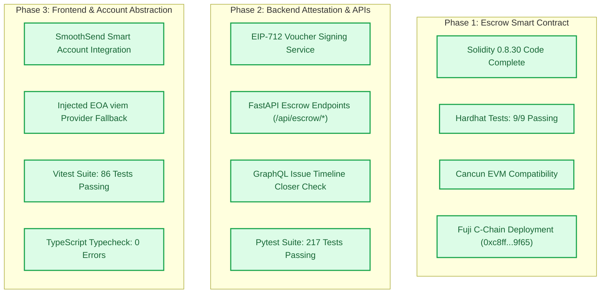

# GitBounty Implementation Audit & Launch Gates

---

## 1. Audit Summary

This document records the verification status of GitBounty across smart contracts, backend APIs, frontend interfaces, and cryptographic attestation mechanisms.

---

## 2. Component Verification Checklist

### 2.1 Smart Contract Layer
* [x] **Solidity Contract:** [`GitBountyEscrow.sol`](file:///c:/Users/dipes/Coding/Webdev/Gitbounty/main-gitbounty/gitbounty/contracts/contracts/GitBountyEscrow.sol) implemented with OpenZeppelin `SafeERC20`, `ReentrancyGuard`, `ECDSA`, and `EIP712`.
* [x] **EVM Target:** Hardhat compiler explicitly pinned to `cancun` with 200 optimizer runs.
* [x] **Deterministic Tests:** 9 test cases in [`GitBountyEscrow.ts`](file:///c:/Users/dipes/Coding/Webdev/Gitbounty/main-gitbounty/gitbounty/contracts/test/GitBountyEscrow.ts) covering:
  * Exact funding and balance tracking.
  * Fee-on-transfer token rejection.
  * Permissionless settlement to signed recipient with double-spend blocking.
  * Rejection of altered terms, invalid signers, and malformed signatures.
  * Boundary test: settlement just before deadline vs refund at/after boundary.
  * State preservation upon ERC-20 transfer failure.
  * Conservation of liabilities despite direct token donations.
  * Shared EIP-712 golden vector match across Python, Solidity, and viem.
* [x] **Fuji Deployment:** Contract deployed at `0xc8ff1527BF4d43A3bC7EA3d9fb415D5647739f65` (Block `59609397`).

### 2.2 Backend & Attestation Engine
* [x] **Cryptographic Signing:** [`app/crypto.py`](file:///c:/Users/dipes/Coding/Webdev/Gitbounty/main-gitbounty/gitbounty/backend/app/crypto.py) computes and signs EIP-712 settlement vouchers.
* [x] **Chain Log Verification:** [`app/escrow_chain.py`](file:///c:/Users/dipes/Coding/Webdev/Gitbounty/main-gitbounty/gitbounty/backend/app/escrow_chain.py) decodes event topics, validates block timestamps, and checks confirmations via Fuji JSON-RPC.
* [x] **Strict Cash Eligibility:** Enforces:
  * Repository within active GitHub App installation.
  * PR merged into default branch.
  * PR body contains closing keyword referencing single same-repo issue.
  * GitHub GraphQL `ClosedEvent.closer` matches the PR.
  * Non-self author (distinct from maintainer and repo owner).
  * `fundedAt <= mergedAt < workEndsAt`.
* [x] **Backend Test Suite:** 217 passing unit, mock, and cryptographic tests via Pytest.

### 2.3 Frontend & Wallet Experience
* [x] **Managed Wallets:** SmoothSend SDK integration provides gasless ERC-4337 smart account execution for maintainers and contributors.
* [x] **Direct EOA Discovery:** `viem` integration allows browser wallet interaction for non-managed accounts.
* [x] **Explicit Review Panels:** Funding and claim flows require explicit review of contract address, token, amount, and recipient before submission.
* [x] **Frontend Tests:** 86 passing tests in Vitest across 11 test suites.
* [x] **Type Safety:** Next.js route typegen and `tsc --noEmit` passing with 0 errors.

---

## 3. Remaining Operational Gates

1. **Two-Account Live Proof Recording:** Complete the recorded rehearsal run between maintainer (`dipesh4000`) and contributor (`dipesh-BS`) on Avalanche Fuji and record the transaction hashes in [live-demo-run.md](live-demo-run.md).
2. **Demo Video:** Record the 3-minute video presentation showing maintainer funding, contributor PR merge, and gas-sponsored claim on Fuji.
3. **Owner Source Publication & License:** Owner attaches the intended open-source license (e.g., MIT / Apache-2.0) before final public release.
