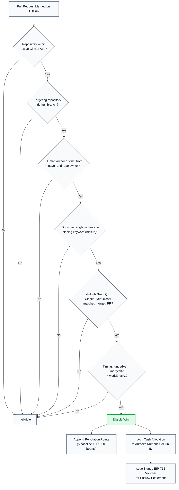
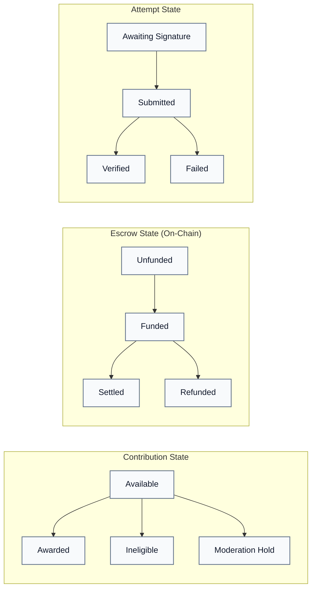
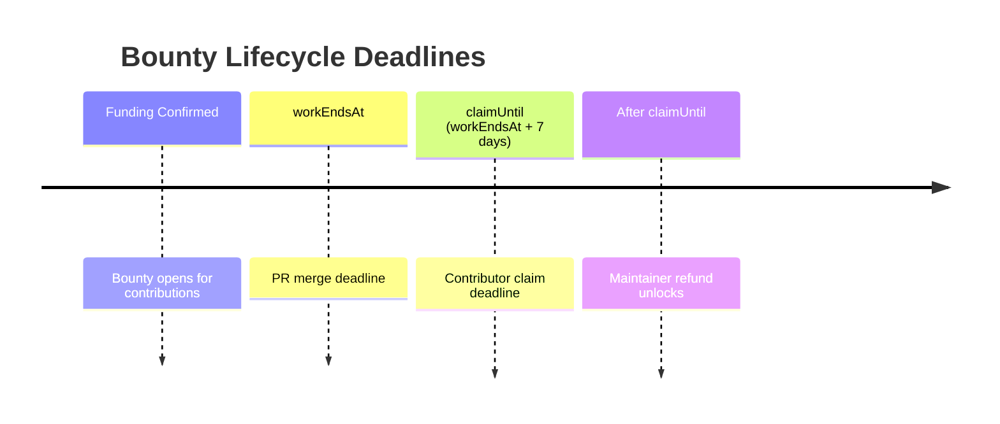

# GitBounty Reward and Eligibility Rules

Reviewed and updated for the live Avalanche Fuji release.

GitBounty maintains a strict division between **off-chain reputation points** and **on-chain funded escrow rewards**. Points reflect open-source contribution history and never convert into cryptocurrency. Cash rewards are funded in USDC and escrowed on Avalanche Fuji.

---

## 1. System Invariants & Eligibility Flow

---

## 2. Identity & Attribution

* The **stable numeric GitHub ID** of the PR author owns the award.
* Usernames, display names, maintainer overrides, email addresses, and browser headers **cannot** alter or claim the award.
* **Pre-registration Safety:** A contributor may register on GitBounty after their PR merges; the allocation is preserved in a pending state and automatically bound upon initial login.

---

## 3. Off-Chain Reputation Points (points-v1)

* **Baseline Award:** 5 points for any eligible merged pull request in a registered repository.
* **Bounty Award:** 1–1,000 points assigned by the maintainer upon bounty creation.
* **Separation:** A 40-point bounty yields 45 points total across two distinct ledger entries (`baseline` and `bounty`).
* **Categories:** `frontend`, `backend`, `fullstack`, `docs`, `testing`, `devops`, `design`, `mobile`, `other`.
* **Append-Only:** Adjustments append new ledger entries; historical points records are immutable.

---

## 4. Cash Reward Eligibility Criteria

Automatic cash allocation requires:

1. Public repository within an active GitHub App installation.
2. Verified numeric repository, issue, PR, and author IDs.
3. Canonically confirmed escrow funding on Avalanche Fuji prior to PR merge.
4. PR merged into the repository default branch (`main` / `master`).
5. One supported closing keyword (`closes`, `fixes`, `resolves`) in the PR body referencing exactly one funded issue in that repository.
6. Timing condition: $\text{fundedAt} \le \text{mergedAt} < \text{workEndsAt}$.
7. Human author distinct from the bounty publisher, escrow payer, and repository owner.
8. GraphQL `ClosedEvent.closer` timeline confirmation.
9. No active moderation hold on the repository or author.

---

## 5. Three Independent State Dimensions

| Dimension | States |
|---|---|
| **Contribution** | `available`, `awarded`, `ineligible`, `moderation_hold` |
| **Escrow** | `unfunded`, `funded`, `settled`, `refunded` |
| **Attempt** | `awaiting_signature`, `submitted`, `verified`, `failed` |

---

## 6. Claim and Refund Deadlines

* $\text{workEndsAt}$: The deadline before which an eligible PR must be merged on GitHub.
* $\text{claimUntil} = \text{workEndsAt} + 7\text{ days}$: The deadline by which the contributor must redeem their voucher on Avalanche.
* **Settlement Condition:** Requires $\text{block.timestamp} < \text{deadline} \le \text{claimUntil}$.
* **Refund Condition:** Requires $\text{block.timestamp} \ge \text{claimUntil}$. Can be called by anyone; funds always return to the recorded payer.
