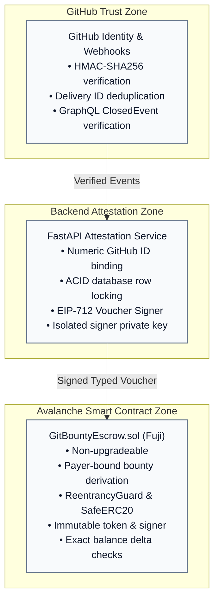
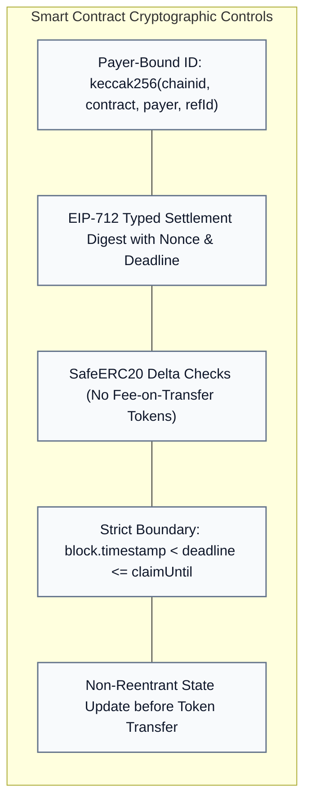

# GitBounty Security and Trust Boundaries

GitBounty binds developer identity on GitHub to financial transactions moving tokens on Avalanche. Identity mapping, settlement authorization, contract state, and receipt verification are treated as security-critical.

---

## 1. Security Architecture & Threat Model

---

## 2. Trust Model & System Responsibilities

| Actor / Component | Trusted For | NOT Trusted For |
|---|---|---|
| **GitHub** | Repository permissions, PR authorship, merge event, default branch, and numeric user ID (`author.id`). | Wallet ownership, crypto knowledge, or payment receipt. |
| **GitBounty Backend** | Validating PR eligibility, issuing signed EIP-712 vouchers, and tracking reputation points. | Custody of user funds (contract holds funds) or arbitrary wallet spending. |
| **Escrow Smart Contract** | Fund custody, token transfers, non-reentrant state transitions, deadline enforcement, and replay prevention. | Understanding PR details or judging code quality. |
| **Avalanche RPC** | Transporting blocks, logs, and transaction receipts. | Settlement truth without backend receipt and log verification. |
| **Account Abstraction (SmoothSend)** | Submitting `UserOperation` bundles and sponsoring gas. | Determining reward eligibility, amounts, or voucher validity. |

---

## 3. Cryptographic & Contract Controls

1. **Non-Upgradeable Design:** `GitBountyEscrow.sol` has no owner keys, pause triggers, token registries, or rescue backdoors. Once deployed, rules are immutable.
2. **Payer-Bound Bounty IDs:** The contract derives `bountyId` using `msg.sender` as `payer`. Third parties cannot hijack a maintainer's reference or front-run funding.
3. **Double-Spend & Replay Protection:** A bounty transitions from `Funded` to `Settled` exactly once. Nonce validation and EIP-712 digest consumption eliminate replay attacks.
4. **Conservation of Liabilities:** Accidental or malicious direct token donations to the contract address do not alter `totalLiabilities` or enable unauthorized withdrawals.

---

## 4. Backend Signer Isolation

The backend settlement signer (`0xf066119be9A9684a81Bd40B153A2E79d5451a8e0`) is a dedicated key:
* **Separation:** Independent from the deployer account, maintainer wallets, or user accounts.
* **Storage:** Injected strictly via environment secret (`ESCROW_AUTHORIZATION_SIGNER_KEY`); never exposed to frontend code or client bundles.
* **Idempotency:** Requesting a voucher for an awarded bounty returns the identical authorization digest.
* **Audit Trail:** Every issued authorization is logged with associated GitHub delivery, repository, and author IDs.

---

## 5. Webhook Security & Idempotency

* **Raw-Byte HMAC Verification:** Webhook payloads are verified against raw request bytes using constant-time comparison before any JSON deserialization.
* **Delivery ID Uniqueness:** GitHub `X-GitHub-Delivery` GUIDs are stored in PostgreSQL with unique constraints. Duplicate deliveries are safely acknowledged and discarded without re-processing.
* **Post-Merge Editing Protection:** Issue closure must be proven by GitHub's `ClosedEvent.closer` timeline item. Adding keywords to a PR body *after* merge does not satisfy eligibility.
