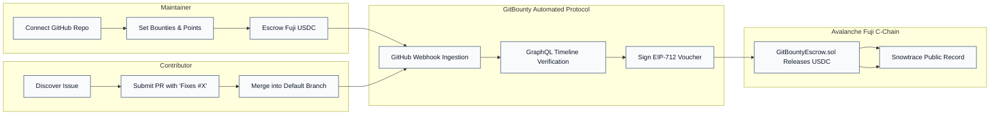
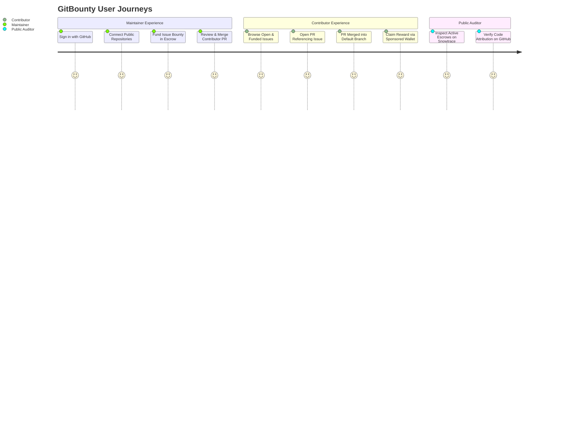
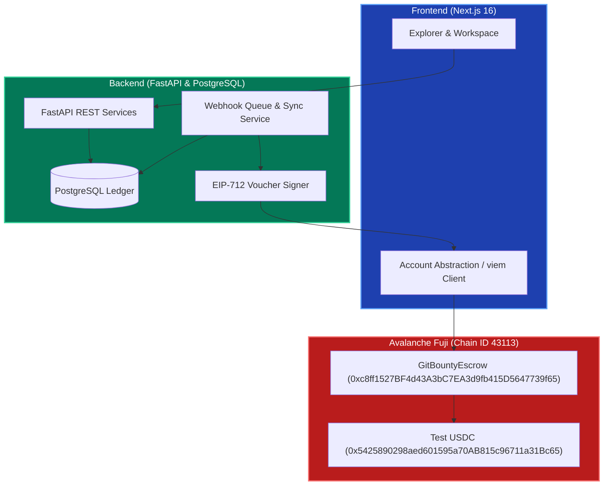

# GitBounty Product Overview

GitBounty turns verified GitHub contributions into transparent points and escrow-backed Avalanche rewards for the developer who authored the merged pull request.

---

## One-Line Description

**GitBounty links cryptographically verified GitHub pull request merges with on-chain Avalanche Fuji escrow settlements, ensuring open-source contributors get paid accurately and reliably without custody risk.**

---

## The Problem

Open-source maintainers struggle to attract and compensate contributors with credible, guaranteed payouts. Traditional bounty platforms suffer from:
1. **Unfunded "Promises":** Bounties advertised without on-chain lockup frequently go unpaid or spark disputes.
2. **Subjective & Manual Approvals:** Payment relies on maintainers manually transferring money off-platform or approving subjective submissions.
3. **Identity Ambiguity:** GitHub usernames can change or be deleted, allowing spoofing or loss of attribution.
4. **Onboarding Friction:** Web3 bounty platforms often force Web2 developers to manage seed phrases and buy native gas tokens before contributing.

---

## The Solution

GitBounty resolves these problems with a unified, verified lifecycle:

* **GitHub Proves the Work:** Merges, default-branch targets, and closing keyword links are verified via signed GitHub webhooks and authenticated GitHub GraphQL queries.
* **Avalanche Proves the Settlement:** Bounties must be locked into `GitBountyEscrow.sol` before work starts. Settlement executes on Avalanche Fuji in test USDC.
* **Zero Gas Friction via Account Abstraction:** Contributors and maintainers can use SmoothSend-sponsored ERC-4337 smart accounts without needing native AVAX for gas. External browser wallets (Core, MetaMask, Rabby) remain fully supported.
* **Separation of Concerns:** Reputation points are an off-chain, append-only ledger that never converts into cryptocurrency, avoiding financialization of open-source badges.

---

## Target User Experiences

### 1. Maintainer
* Signs in with GitHub OAuth and connects public repositories via the GitHub App.
* Chooses an open issue, assigns reputation points, category, work deadline, and funding amount in USDC.
* Funds the non-upgradeable `GitBountyEscrow` contract on Avalanche Fuji.
* Monitors lifecycle status, claim windows, and retains the right to reclaim funds if a bounty remains unclaimed after the 7-day grace period.

### 2. Contributor
* Discovers published bounties with clear badges (Funded USDC vs. Points-only).
* Works via standard Git workflow and opens a pull request referencing the issue (`Closes #42`).
* Can register on GitBounty before or after the pull request merges without losing attribution.
* Claims rewards using either a SmoothSend-sponsored smart account (gasless) or direct EOA wallet.

### 3. Public Auditor
* Reviews live bounties, repository links, and verifiable on-chain settlements without signing in.
* Audits smart contract transactions and liabilities directly on Snowtrace.

---

## Core Product Invariants

| Invariant | Guarantee |
|---|---|
| **Author Ownership** | Rewards belong strictly to the numeric GitHub ID (`author.id`) of the developer who authored the merged PR. |
| **No Double Award** | The first verified eligible merge claims the reward under a database transaction lock; subsequent merges cannot trigger a duplicate payout. |
| **No Fake Funding** | A bounty is only marked "Funded" after its on-chain deposit event is indexed with canonical confirmations. |
| **Clean Reputation** | Points reflect developer reputation across categories (frontend, backend, security, docs) and never convert into currency. |
| **Tamper-Proof Settlement** | Payouts require an EIP-712 typed voucher signed by the backend attestation key; the contract verifies signature, recipient, token, amount, and deadline. |
| **Guaranteed Reclaim Window** | If an issue is not merged before `workEndsAt` or claimed within `claimUntil = workEndsAt + 7 days`, the payer can withdraw their deposit in full. |

---

## System Architecture Summary

---

## Hackathon Scope & Success Metrics

* **Chain:** Avalanche Fuji C-Chain (Chain ID `43113`).
* **Contract:** `GitBountyEscrow.sol` deployed at `0xc8ff1527BF4d43A3bC7EA3d9fb415D5647739f65`.
* **Asset:** Official Fuji test USDC (`0x5425890298aed601595a70AB815c96711a31Bc65`).
* **Test Verification:**
  * 9/9 smart contract test cases passing.
  * 86/86 frontend integration tests passing with 0 TypeScript errors.
  * 217 backend unit and cryptographic tests passing.
