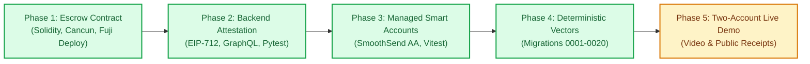
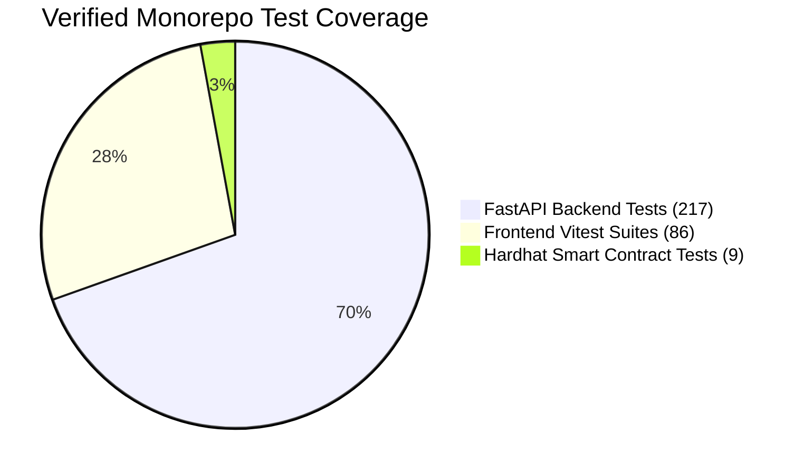

# GitBounty Hackathon Implementation Plan & Roadmap

---

## 1. Roadmap & Milestone Progress

---

## 2. Milestone Status Matrix

| Phase | Milestone Description | Exit Criteria | Status |
|---|---|---|---|
| **Phase 1** | **Escrow Contract & Fuji Deployment** | `GitBountyEscrow.sol` tested (9/9 pass) and deployed to Fuji C-Chain at `0xc8ff1527BF4d43A3bC7EA3d9fb415D5647739f65`. | **Completed** |
| **Phase 2** | **Backend Attestation & Eligibility** | EIP-712 signer implemented; GraphQL timeline closer check; 217 backend tests passing. | **Completed** |
| **Phase 3** | **Frontend & Account Abstraction** | SmoothSend SDK gas-sponsored execution; explicit review panels; 86 Vitest tests passing; 0 type errors. | **Completed** |
| **Phase 4** | **Schema Migrations & Golden Vectors** | Numbered PostgreSQL migrations 0001–0020 applied; cross-language EIP-712 vector matching Solidity, Python, and viem. | **Completed** |
| **Phase 5** | **Live Rehearsal & Submission Package** | Two-account GitHub run (`dipesh4000` / `dipesh-BS`), 3-minute video recording, and slide deck. | **In Progress** |

---

## 3. Account Abstraction & Custody Architecture

Per product requirements:
1. **GitHub Native OAuth:** Preserves standard GitHub OAuth for login and repository App installations.
2. **Managed Signer Provisioning:** On verified GitHub sign-in, the backend provisions an encrypted managed signer bound to the user's numeric GitHub ID.
3. **SmoothSend ERC-4337 Smart Account:** Maintainers and contributors execute funding, claims, and refunds via developer-sponsored `UserOperation` bundles without paying native gas or managing seed phrases.
4. **Direct Web3 Wallet Fallback:** Injected browser wallets (Core, MetaMask, Rabby) remain fully supported via `viem`.

---

## 4. Verification & Testing Deliverables

* **Smart Contracts:** 9/9 passing in Hardhat (`node:test`).
* **Frontend:** 86/86 passing in Vitest; Next.js route typegen clean.
* **Backend:** 217 passing unit, mock, and cryptographic tests in Pytest.
