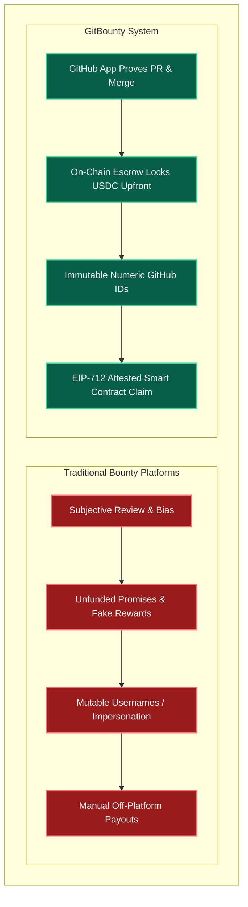
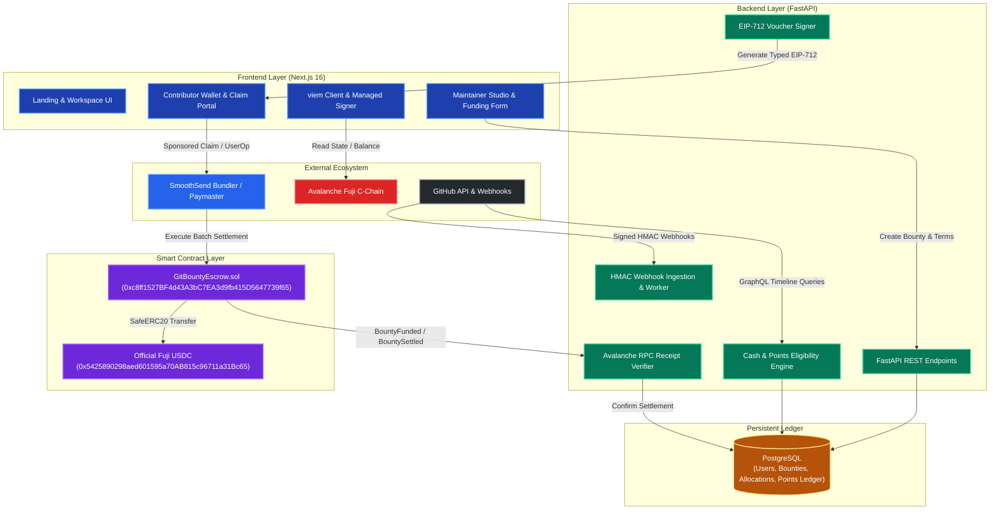
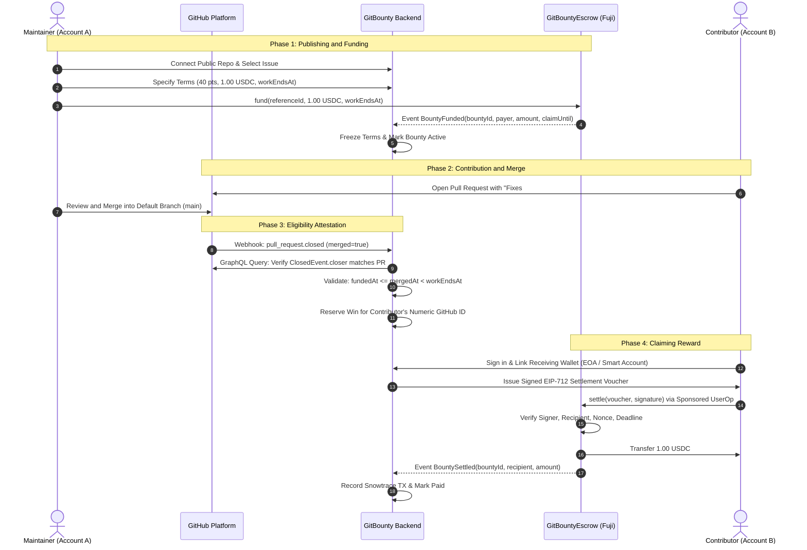
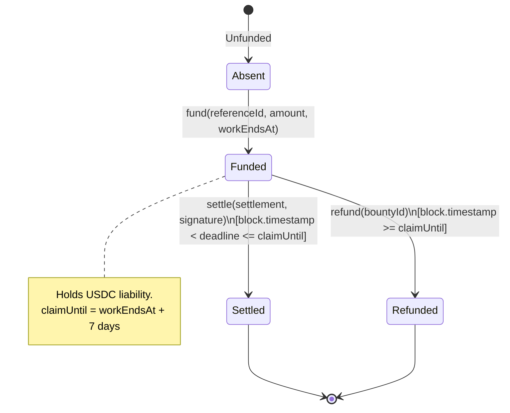
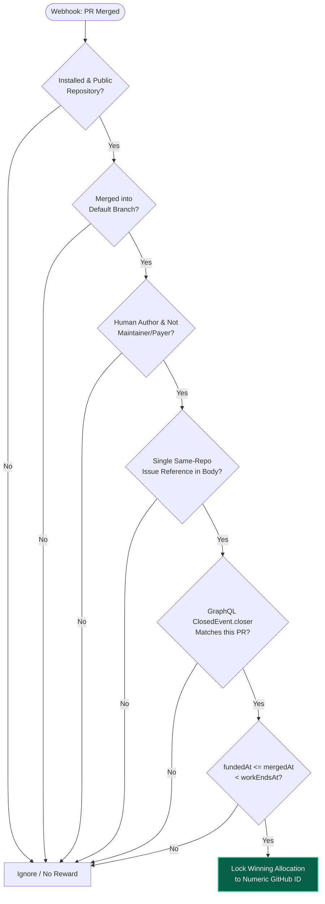
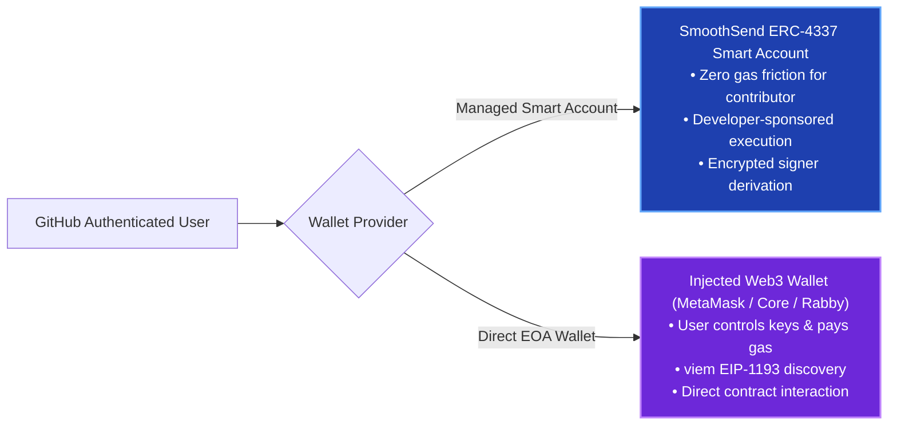

# GitBounty

> **Turn verified GitHub contributions into transparent reputation points and escrow-backed Avalanche rewards for the developer who actually authored the merged pull request.**

[-E84142?logo=avalanche&logoColor=white)](https://testnet.snowtrace.io/address/0xc8ff1527BF4d43A3bC7EA3d9fb415D5647739f65)
[](https://testnet.snowtrace.io/address/0xc8ff1527BF4d43A3bC7EA3d9fb415D5647739f65)
[](https://nextjs.org/)
[](https://fastapi.tiangolo.com/)
[%20|%20Web%20(86)%20|%20Backend%20(217)-success)](#verification-and-test-results)

**Live Demo Application:** [gitbounty-web.vercel.app](https://gitbounty-web.vercel.app)  
**Escrow Contract on Snowtrace:** [0xc8ff1527BF4d43A3bC7EA3d9fb415D5647739f65](https://testnet.snowtrace.io/address/0xc8ff1527BF4d43A3bC7EA3d9fb415D5647739f65)

---

## Table of Contents

1. [Executive Summary](#executive-summary)
2. [The Problem & The Solution](#the-problem--the-solution)
3. [Core Invariants & Guarantees](#core-invariants--guarantees)
4. [System Architecture](#system-architecture)
5. [End-to-End User Journey](#end-to-end-user-journey)
6. [Smart Contract & Escrow Mechanics](#smart-contract--escrow-mechanics)
7. [GitHub Eligibility Verification Engine](#github-eligibility-verification-engine)
8. [Wallet Strategy & Account Abstraction](#wallet-strategy--account-abstraction)
9. [Technology Stack](#technology-stack)
10. [Repository Structure](#repository-structure)
11. [Verification and Test Results](#verification-and-test-results)
12. [Local Development Setup](#local-development-setup)
13. [Deployed Network Artifacts](#deployed-network-artifacts)

---

## Executive Summary

**GitBounty** is an open-source contribution incentivization platform combining cryptographic verification from GitHub with decentralized escrow settlements on the **Avalanche (Fuji C-Chain)** network.

Maintainers connect their public GitHub repositories, publish bounties on selected issues, and pre-fund cash rewards using testnet USDC into a non-upgradeable Solidity escrow contract (`GitBountyEscrow.sol`). Contributors browse issues, solve them through standard pull requests, and receive automated attribution. Once GitBounty authoritatively verifies the PR merge, branch target, closing reference, and author identity, the author can claim the escrowed reward via gas-sponsored smart accounts or standard web3 wallets.

Reputation points exist as an immutable, off-chain ledger that tracks developer contributions across categories without monetary speculation.

---

## The Problem & The Solution



* **Trustless Pre-funding ("Funded means Funded"):** Maintainers cannot announce cash bounties without locking the exact token amount into the smart contract. Contributors work knowing funds exist.
* **Objective GitHub Evidence:** Merges, closing keywords, and timeline events are verified via signed GitHub webhooks and authenticated GraphQL queries.
* **Resilient Identity:** Rewards belong strictly to the author's immutable numeric GitHub ID (`author.id`), protecting contributors against username changes or handle re-registrations.
* **Clean Boundary:** Points quantify open-source reputation and never convert to currency; cash rewards are funded in USDC and settled transparently on Avalanche.

---

## Core Invariants & Guarantees

* **Numeric Identity Ownership:** Every allocation is keyed to `github_user_id` (e.g. `87355477`), not a string username.
* **First Eligible Allocation Processing:** The first verified pull request that fulfills all conditions claims the allocation under an ACID database lock.
* **Pre-Registration Safety:** If a contributor authors an eligible PR before registering on GitBounty, their allocation is preserved safely in the database and can be claimed immediately upon signing in.
* **Replay & Double-Spend Protection:** The escrow contract enforces single-use settlement with unique `bountyId` derivations (`keccak256(chainid, contract, payer, referenceId)`), nonce checks, and EIP-712 typed voucher verification.
* **Bounded Work and Claim Deadlines:** Each bounty enforces a `workEndsAt` cutoff for code merges, followed by a strict 7-day claim grace window (`claimUntil = workEndsAt + 7 days`).
* **Non-Custodial Refund Path:** If a bounty expires without an eligible claim, the original maintainer can reclaim the escrowed USDC directly on-chain after `claimUntil`.

---

## System Architecture



---

## End-to-End User Journey



---

## Smart Contract & Escrow Mechanics

The core contract is [`GitBountyEscrow.sol`](file:///c:/Users/dipes/Coding/Webdev/Gitbounty/main-gitbounty/gitbounty/contracts/contracts/GitBountyEscrow.sol), written in Solidity 0.8.30 with OpenZeppelin cryptographic and security libraries.

### State Transition Diagram



### Key Contract Features
* **Payer-Bound Bounty IDs:**
  $$\text{bountyId} = \text{keccak256}(\text{abi.encode}(\text{block.chainid}, \text{address}(this), \text{msg.sender}, \text{referenceId}))$$
  Ensures third parties cannot front-run or disrupt a maintainer's funding parameters.
* **EIP-712 Settlement Voucher:**
  ```solidity
  struct Settlement {
      bytes32 bountyId;
      address recipient;
      address token;
      uint256 amount;
      uint256 nonce;
      uint256 deadline;
  }
  ```
  The digest is hashed according to EIP-712 domain rules (`name: "GitBountyEscrow"`, `version: "1"`, `chainId: 43113`, `verifyingContract: 0xc8ff...9f65`).
* **Conservation of Liabilities:** Direct accidental donations to the contract address do not dilute tracked liabilities or permit unauthorized balance withdrawals.
* **Fail-Safe Reentrancy & SafeERC20:** Protected with OpenZeppelin `ReentrancyGuard` and `SafeERC20`. State mutations precede all external token transfers.

---

## GitHub Eligibility Verification Engine

GitBounty strictly enforces automated validation before any cash allocation is authorized:



1. **Closing Keywords:** Requires standard GitHub keywords (`close`, `closes`, `closed`, `fix`, `fixes`, `fixed`, `resolve`, `resolves`, `resolved`) explicitly in the PR body.
2. **GraphQL Event Verification:** Uses GitHub's GraphQL API to read the issue `timelineItems` and confirm that the issue was closed by a `ClosedEvent` whose `closer` is the exact merged PR.
3. **No Retrospective Exploits:** Adding keywords to PR bodies or issues *after* merge does not establish closure.

---

## Wallet Strategy & Account Abstraction

GitBounty supports both frictionless developer onboarding and decentralized custody:



* **SmoothSend Account Abstraction:** Automatically provisions an encrypted managed signer for GitHub users. Claims and funding can execute via sponsored `UserOperation` bundles without requiring contributors to hold native Fuji AVAX.
* **Direct EOA Fallback:** Developers preferring standalone wallets can connect their browser extension (Core, MetaMask, Rabby) via `viem`.

---

## Technology Stack

```text
┌────────────────────────────────────────────────────────────────────────┐
│                              FRONTEND                                  │
│  Next.js 16.4.6 (App Router) • React 19.3.0 • TypeScript • viem 2.57   │
│  Tailwind CSS • Vitest 5.0.3 • Testing Library • SmoothSend SDK 2.3    │
└───────────────────────────────────┬────────────────────────────────────┘
                                    │ Same-origin proxy / REST
┌───────────────────────────────────▼────────────────────────────────────┐
│                              BACKEND                                   │
│  FastAPI (Python 3.12) • SQLAlchemy / asyncpg • Pydantic • httpx       │
│  eth-account • eth-abi • cryptography (Fernet) • Pytest                │
└───────────────────────────────────┬────────────────────────────────────┘
                                    │ SQL & EVM RPC
┌─────────────────────────┬─────────┴────────────────────────────────────┐
│       DATABASE          │                  BLOCKCHAIN                  │
│  PostgreSQL (Supabase)  │  Solidity 0.8.30 (cancun EVM target)         │
│  20 Migrations          │  Avalanche Fuji C-Chain (Chain ID: 43113)    │
│  Durable Webhook Queue  │  OpenZeppelin Contracts v5.2.0 • Hardhat 3   │
└─────────────────────────┴──────────────────────────────────────────────┘
```

---

## Repository Structure

```text
gitbounty/
├── contracts/               # Solidity workspace (Hardhat)
│   ├── contracts/
│   │   ├── GitBountyEscrow.sol  # Primary escrow contract
│   │   └── test/MockUSDC.sol    # Deterministic test token
│   ├── deployments/fuji/        # Recorded Fuji deployment artifacts & env
│   ├── scripts/fuji.mjs         # Deployment and inspection scripts
│   └── test/GitBountyEscrow.ts  # Hardhat / node:test contract test suite
├── backend/                 # FastAPI application
│   ├── app/
│   │   ├── features/
│   │   │   ├── merged_prs/  # PR categorization, parsing, and lifecycle
│   │   │   └── points/      # Off-chain points ledger engine
│   │   ├── routes/          # REST endpoints (escrow, maintainer, issues, auth)
│   │   ├── crypto.py        # EIP-712 typed signing & hash validation
│   │   ├── escrow_chain.py  # Avalanche Fuji RPC and log decoder
│   │   └── managed_wallets.py # SmoothSend smart account management
│   └── tests/               # Backend test suite (Pytest)
├── frontend/
│   ├── web/                 # Next.js 16 Web Application
│   │   ├── app/             # App router pages (bounties, wallet, maintainers)
│   │   ├── components/      # UI components (escrow cards, claim modal)
│   │   └── tests/           # Vitest component & integration tests
│   └── extension/           # Optional browser extension
├── migrations/              # Numbered PostgreSQL schema migrations (0001 - 0020)
└── docs/                    # Architecture, specifications, and runbooks
```

---

## Verification and Test Results

All test suites and compilers across the entire monorepo pass cleanly:

### 1. Smart Contract Suite (Hardhat & Node.js)
```text
  GitBountyEscrow
    ✔ funds the payer-derived ID with the exact token amount
    ✔ rejects fee-on-transfer funding without leaving state behind
    ✔ settles permissionlessly to the signed recipient and blocks replay/refund
    ✔ rejects altered terms, the wrong signer/domain, and malformed signatures
    ✔ allows settlement just before the boundary and refund at the boundary
    ✔ preserves funded state when a token transfer fails
    ✔ keeps cross-bounty liabilities conserved despite direct donations
    ✔ rejects invalid constructor and funding terms
    ✔ matches the shared viem, Solidity, and Python EIP-712 golden vector

  9 passing (100% pass rate)
```

### 2. Frontend Test Suite & Static Analysis (Next.js / Vitest)
```text
  Test Files  11 passed (11)
       Tests  86 passed (86)
   Typecheck  next typegen && tsc --noEmit (0 errors)
```

### 3. Backend Test Suite (FastAPI / Pytest)
```text
  217 passed, 144 skipped (isolated local postgres DB tests), 0 failed
```

---

## Local Development Setup

### Prerequisites
* **Node.js:** v24.x
* **Python:** 3.12 with `uv`
* **PostgreSQL:** v15+

### 1. Smart Contracts
```powershell
cd gitbounty/contracts
npm install
npm test
```

### 2. Backend API
```powershell
cd gitbounty/backend
uv sync --locked
& .venv\Scripts\python.exe -m pytest tests -q
& .venv\Scripts\uvicorn.exe app.main:app --reload --port 8001
```

### 3. Frontend Web
```powershell
cd gitbounty/frontend/web
npm install
npm run typecheck
npm test
npm run dev
```
Open [http://localhost:3000](http://localhost:3000) in your browser.

---

## Deployed Network Artifacts

| Parameter | Value | Explorer Link |
|---|---|---|
| **Network** | Avalanche Fuji C-Chain | Chain ID `43113` |
| **Escrow Contract** | `0xc8ff1527BF4d43A3bC7EA3d9fb415D5647739f65` | [Snowtrace Address](https://testnet.snowtrace.io/address/0xc8ff1527BF4d43A3bC7EA3d9fb415D5647739f65) |
| **Deployment TX** | `0x302e9e0dce61ad1dd1fa8a7dccbca71c9f7d3f15a185ee0204fa728b84952e4d` | [Snowtrace Transaction](https://testnet.snowtrace.io/tx/0x302e9e0dce61ad1dd1fa8a7dccbca71c9f7d3f15a185ee0204fa728b84952e4d) |
| **Deployment Block**| `59609397` | Block confirmation on Fuji |
| **Official Test USDC**| `0x5425890298aed601595a70AB815c96711a31Bc65` | [Snowtrace Token](https://testnet.snowtrace.io/token/0x5425890298aed601595a70AB815c96711a31Bc65) |
| **Authorization Signer**| `0xf066119be9A9684a81Bd40B153A2E79d5451a8e0` | Backend attestation EOA |
| **Deployer Address**| `0x2867ab18c8E9a31AD29fE501d45ce3E50fB016aB` | Deployer EOA |
| **Compiler Target** | Solidity `0.8.30`, EVM `cancun` | Optimized (200 runs) |

---

## Documentation Directory

| Document | Purpose |
|---|---|
| [Product Overview](overview.md) | High-level product vision, user personas, and principles |
| [Architecture Specification](docs/architecture.md) | Technical topology, EIP-712 voucher structure, and boundaries |
| [Points & Eligibility Rules](docs/points-rules.md) | Detailed requirements for automated PR merge eligibility |
| [Implementation Audit](docs/implementation-audit.md) | Verification checklist and milestone tracking |
| [Hackathon Submission](docs/hackathon-submission.md) | Avalanche Builder Hub submission package & evidence |
| [Security Controls](docs/security.md) | Threat modeling, cryptographic controls, and signer isolation |
| [Setup Guide](docs/setup.md) | Complete environment configuration and local setup instructions |
| [Verification Runbook](docs/testing-data.md) | Deterministic and live verification runbooks |
